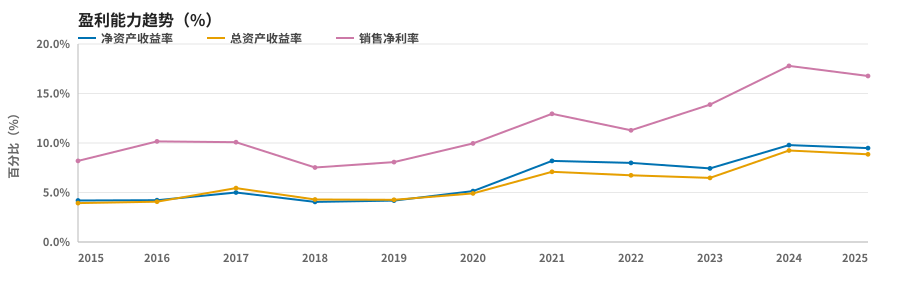
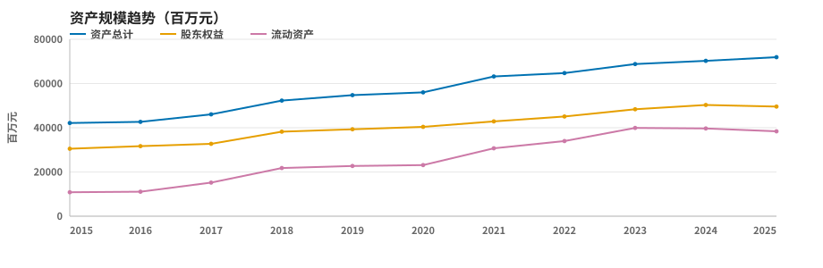
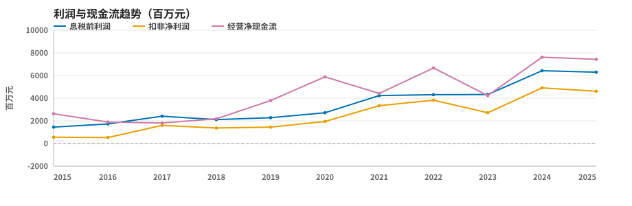
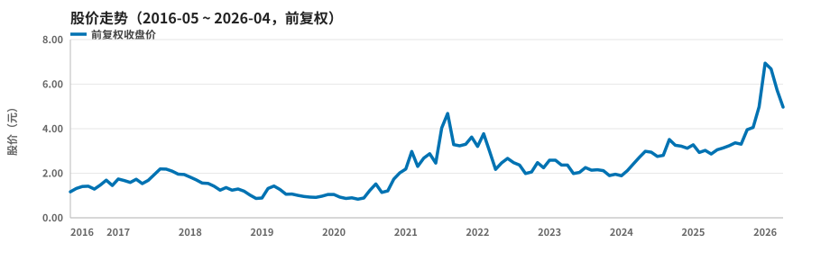

# 南山铝业（600219.SH）CM 手册

> 制表日期：2026/05/06　|　报告指标日期：2026-05-06（报告日最近交易日）　|　财务指标截至：2025 年报

| 报告指标日期 | 当前股价（元） | 当前市值（亿元） | 静态市盈率 | 静态市净率 | 动态市盈率 | 市净率 |
| :-- | --: | --: | --: | --: | --: | --: |
| 2026-05-06 | 5.48 | 623 | 13.15 | 1.26 | 15.07 | 1.22 |

> 静态 PE/PB 采用 2025 年报归母净利润/归母股东权益；动态 PE 采用 TTM 归母净利润；市净率采用 2026-03-31 归母股东权益。当前股价/市值取报告指标日期当日收盘价与最新披露股本。

## 一、盈利能力与偿债能力

| 指标 | 2015 | 2016 | 2017 | 2018 | 2019 | 2020 | 2021 | 2022 | 2023 | 2024 | 2025 |
| :-- | --: | --: | --: | --: | --: | --: | --: | --: | --: | --: | --: |
| 净资产收益率 | 4.19% | 4.22% | 5.00% | 4.05% | 4.19% | 5.14% | 8.19% | 7.99% | 7.44% | 9.79% | 9.48% |
| 总资产收益率 | 3.93% | 4.07% | 5.44% | 4.29% | 4.26% | 4.90% | 7.09% | 6.74% | 6.48% | 9.24% | 8.86% |
| 资产负债率 | 23.37% | 21.46% | 24.72% | 23.02% | 24.12% | 20.93% | 24.78% | 22.72% | 21.49% | 19.98% | 19.28% |
| 销售毛利率 | 18.80% | 22.66% | 22.58% | 17.38% | 21.51% | 23.72% | 24.63% | 20.91% | 20.34% | 27.18% | 25.20% |
| 销售净利率 | 8.19% | 10.16% | 10.08% | 7.53% | 8.07% | 9.96% | 12.95% | 11.28% | 13.88% | 17.79% | 16.77% |
| 流动比率 | 1.65 | 1.67 | 2.01 | 2.38 | 2.08 | 2.17 | 2.04 | 2.45 | 2.83 | 3.04 | 2.93 |
| 总资产周转率 | 0.37 | 0.31 | 0.38 | 0.41 | 0.40 | 0.40 | 0.48 | 0.55 | 0.43 | 0.48 | 0.49 |

## 二、资产负债结构（百万元）

| 指标 | 2015 | 2016 | 2017 | 2018 | 2019 | 2020 | 2021 | 2022 | 2023 | 2024 | 2025 |
| :-- | --: | --: | --: | --: | --: | --: | --: | --: | --: | --: | --: |
| 资产总计（百万元） | 42,150 | 42,685 | 46,041 | 52,299 | 54,759 | 56,012 | 63,178 | 64,726 | 68,815 | 70,264 | 71,917 |
| 股东权益（百万元） | 30,489 | 31,675 | 32,744 | 38,228 | 39,309 | 40,385 | 42,867 | 45,102 | 48,344 | 50,317 | 49,587 |
| 货币资金（百万元） | 4,584 | 4,083 | 5,571 | 6,305 | 10,346 | 13,227 | 18,273 | 20,875 | 26,388 | 25,662 | 24,553 |
| 流动资产（百万元） | 10,818 | 11,071 | 15,173 | 21,759 | 22,724 | 23,125 | 30,697 | 33,994 | 39,926 | 39,683 | 38,385 |
| 非流动资产（百万元） | 31,331 | 31,615 | 30,868 | 30,540 | 32,036 | 32,887 | 32,481 | 30,732 | 28,889 | 30,581 | 33,532 |
| 流动负债（百万元） | 6,574 | 6,621 | 7,555 | 9,130 | 10,941 | 10,668 | 15,014 | 13,878 | 14,112 | 13,045 | 13,117 |
| 非流动负债（百万元） | 3,276 | 2,541 | 3,825 | 2,911 | 2,270 | 1,057 | 640 | 830 | 675 | 994 | 748 |
| 存货（百万元） | 3,840 | 3,836 | 4,564 | 5,241 | 5,118 | 4,624 | 6,429 | 6,436 | 6,272 | 6,470 | 8,131 |
| 固定资产（百万元） | 19,001 | 23,228 | 25,975 | 25,010 | 24,598 | 23,192 | 27,504 | 26,381 | 24,433 | 23,168 | 26,057 |
| 商誉（百万元） | NA | NA | NA | NA | NA | NA | NA | NA | NA | NA | NA |
| 短期贷款（百万元） | 1,828 | 1,349 | 2,512 | 3,940 | 4,864 | 5,073 | 8,092 | 7,350 | 7,533 | 5,514 | 5,029 |
| 长期贷款（百万元） | 1,501 | 702 | 356 | 100 | 170 | 350 | NA | 190 | 28 | 200 | NA |

## 三、利润与现金流（百万元）

| 指标 | 2015 | 2016 | 2017 | 2018 | 2019 | 2020 | 2021 | 2022 | 2023 | 2024 | 2025 |
| :-- | --: | --: | --: | --: | --: | --: | --: | --: | --: | --: | --: |
| 主营业务收入（百万元） | 13,777 | 13,228 | 17,068 | 20,222 | 21,509 | 22,299 | 28,725 | 34,951 | 28,844 | 33,477 | 34,620 |
| 营业利润（百万元） | 1,428 | 1,682 | 2,256 | 1,819 | 1,984 | 2,601 | 4,145 | 4,282 | 4,368 | 6,630 | 6,557 |
| 息税前利润（百万元） | 1,449 | 1,728 | 2,414 | 2,111 | 2,281 | 2,716 | 4,227 | 4,312 | 4,325 | 6,426 | 6,296 |
| 扣非净利润（百万元） | 556 | 529 | 1,599 | 1,372 | 1,448 | 1,947 | 3,337 | 3,826 | 2,715 | 4,908 | 4,610 |
| 归母净利润（百万元） | 1,018 | 1,313 | 1,611 | 1,438 | 1,623 | 2,049 | 3,411 | 3,516 | 3,474 | 4,830 | 4,736 |
| 经营净现金流（百万元） | 2,631 | 1,892 | 1,810 | 2,184 | 3,792 | 5,883 | 4,416 | 6,669 | 4,230 | 7,617 | 7,429 |
| 现金及等价物净增（百万元） | 1,090 | -528 | 1,522 | 407 | 2,723 | 4,001 | 3,274 | 3,572 | 3,049 | 131 | -223 |

## 四、股本

| 指标 | 2015 | 2016 | 2017 | 2018 | 2019 | 2020 | 2021 | 2022 | 2023 | 2024 | 2025 |
| :-- | --: | --: | --: | --: | --: | --: | --: | --: | --: | --: | --: |
| 总股本（百万股） | 2,835 | 9,251 | 9,251 | 11,950 | 11,950 | 11,950 | 11,950 | 11,709 | 11,709 | 11,614 | 11,484 |

## 五、股价走势

> 股价图为月线、前复权收盘价；区间为报告日前推 10 年（2016-05-06 ~ 2026-05-06）。前复权价格已按分红送转调整。

## 六、公司概况

| 项目 | 内容 |
| :-- | :-- |
| 公司全称 | 山东南山铝业股份有限公司 |
| 所在城市 | 龙口市 |
| 成立日期 | 19930318 |
| 上市日期 | 19991223 |
| 所属行业 | 铝 |
| 主营业务 | 铝及铝合金制品的开发、生产、加工及销售;电力生产。 |

## 七、年均增长率

| 时间段 | 10年 | 8年 | 5年 | 3年 |
| :-- | --: | --: | --: | --: |
| 主营营收 | 9.65% | 9.24% | 9.20% | -0.32% |
| 净利润 | 16.62% | 14.43% | 18.23% | 10.44% |
| 总资产 | 5.49% | 5.73% | 5.13% | 3.57% |
| 股东权益 | 4.98% | 5.32% | 4.19% | 3.21% |

> 年均增长率为复合增长率（CAGR），区间终点为 2025 年；净利润采用归母净利润。

## 八、季度营收（百万元，累计值）

| 年度 | 一季度 | 二季度 | 三季度 | 四季度 |
| :-- | --: | --: | --: | --: |
| 2026 | 9,067 | NA | NA | NA |
| 2025 | 8,981 | 17,274 | 26,325 | 34,620 |
| 2024 | 7,224 | 15,667 | 24,226 | 33,477 |
| 2023 | 6,834 | 14,501 | 21,690 | 28,844 |
| 2022 | 8,857 | 17,910 | 26,528 | 34,951 |

## 九、季度净利润（百万元，累计值）

| 年度 | 一季度 | 二季度 | 三季度 | 四季度 |
| :-- | --: | --: | --: | --: |
| 2026 | 1,101 | NA | NA | NA |
| 2025 | 1,704 | 2,625 | 3,772 | 4,736 |
| 2024 | 851 | 2,189 | 3,490 | 4,830 |
| 2023 | 519 | 1,313 | 2,142 | 3,474 |
| 2022 | 722 | 1,826 | 2,849 | 3,516 |

## 十、每股分红（元）

| 年度 | 现金 | 送股 | 转增 |
| :-- | --: | --: | --: |
| 20251231 | 0.14 | NA | NA |
| 20241231 | 0.09 | NA | NA |
| 20231231 | 0.12 | NA | NA |
| 20221231 | 0.04 | NA | NA |

---

**口径与免责声明**

- 报告指标日期为 2026-05-06（报告日最近交易日）；当前股价/市值取该日收盘价与最新披露股本。
- 静态 PE/PB 按 2025 年报计算；动态 PE 按 TTM 归母净利润计算；市净率按 2026-03-31 归母股东权益计算。
- 财务三表取自新浪财经按最新披露口径整理的报表，东方财富仅补充扣非净利润、分红报告期等独有字段；历史年度可能包含追溯调整，与当年原始年报披露值可能存在差异。
- 数据来源：腾讯财经（行情、K 线）；新浪财经（财务报表三表、公司资料、行业）；东方财富（扣非净利润、分红报告期、北交所 K 线兜底）。
- 银行、证券、保险等金融企业的报表科目与通用模板不同，流动比率、存货、短期/长期贷款等不适用科目显示 NA。
- 本资料所有数据均来源于可靠的公开资料，但无法确保完全准确。如有错讹，概不负责。
- 本资料仅适用于个人投资者训练投资能力，未获授权，禁止一切形式的复制、转载和交易。
